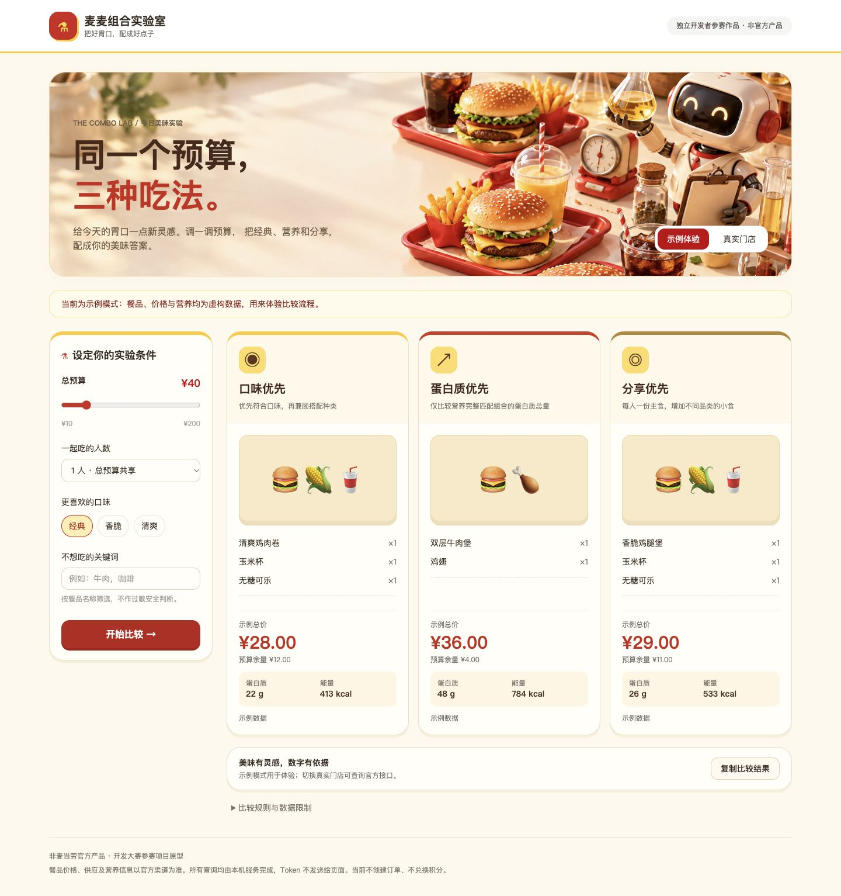

# 麦麦组合实验室

同一个预算，三种吃法。基于麦当劳中国 MCP 的独立开发者参赛项目，用可解释的规则比较口味优先、蛋白质优先、分享优先三个餐盘，并核验真实门店价格。



## 目标用户

想在预算内比较不同搭配的人；想参考蛋白质信息而不愿面对大表格的人；需要和朋友共享总预算的人。

## 安装与启动

需要 Node.js 22.12+（建议24）。

```bash
npm ci
cp .env.example .env
# 在本地 .env 填写自己的 MCD_MCP_TOKEN，勿提交或分享
npm run build
npm start
```

打开 http://localhost:4173 。不配置Token也能体验明确标注的虚构示例模式。开发运行 `npm run dev`（无dist目录时启用Vite中间件）；修改后使用 `npm run build` 更新正式预览。

## 使用示例

1. 示例体验：总预算40元、1人、经典口味 → 开始比较 → 查看三种目标的餐品、金额与营养 → 复制比较结果。
2. 真实体验：切换真实门店 → 输入城市与位置关键词 → 查询并选择营业门店 → 加载门店菜单 → 设置预算与人数 → 开始比较。展示实际接口返回的价格、未知营养与预算冲突。
3. 当多人预算不足时，显示无解原因，调整预算或人数后重算。

## 设计与算法

真实模式严格区分菜单预估与官方核价，整组营养未匹配则不显示误导性总量。主食、配菜和饮品有限候选规则可见 lib/planner.mjs；不声称全菜单最便宜。界面具备示例/真实模式、加载状态、空状态、错误反馈和复制功能。查询流程不下单。

## 检查

```bash
npm test
npm run build
```

详见 MCP_INTEGRATION.md、VALIDATION.md 和 SKILL.md。mcp-config.example.json 仅使用环境变量占位符；需按客户端实际规则配置环境变量。

## 参赛材料

包含 README.md、原样官方 CONTEST_DECLARATION.md、MCP_INTEGRATION.md、脱敏配置示例、可运行源代码和Skill使用指引。项目公开仓库：https://github.com/zlbigger/mcd-combo-lab 。报名状态以官方活动Issue回复为准。真实使用WorkBuddy并导出上下文后才能提交workbuddy.md申请专项奖励，本项目没有伪造该材料。

项目需在个人GitHub账号公开发布，并在2026-10-25 23:59北京时间前到活动仓库提交报名Issue。活动规则：https://github.com/M-China/mcd-developer-innovation-challenge/blob/main/activityGuidelines.md。

非麦当劳官方产品。输出不构成医疗或营养专业建议。价格、供应和营养信息以官方渠道实时结果为准。Token只存本地 .env，发布前勿上传 .env、.private 或个人原始响应。原始品牌餐品图来自MCP返回，用于接口结果展示；发布和使用须遵守官方MCP服务条款。产品界面为本项目编写，无复制第三方参赛代码。
